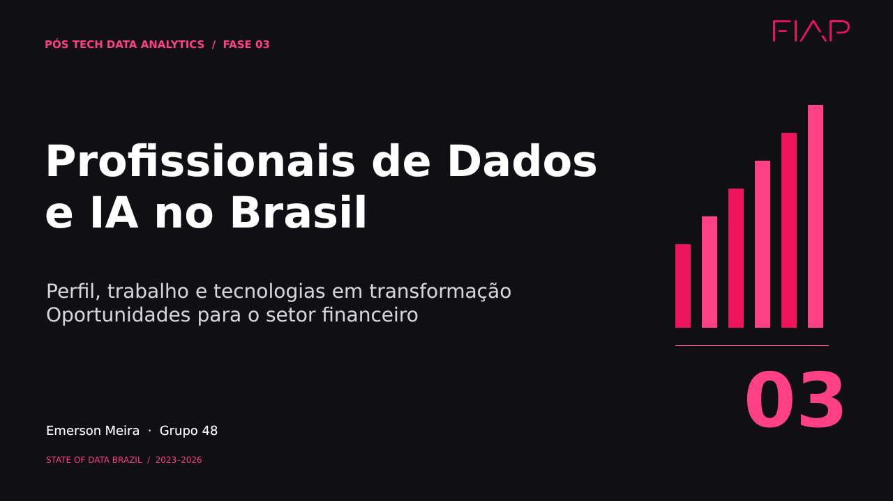
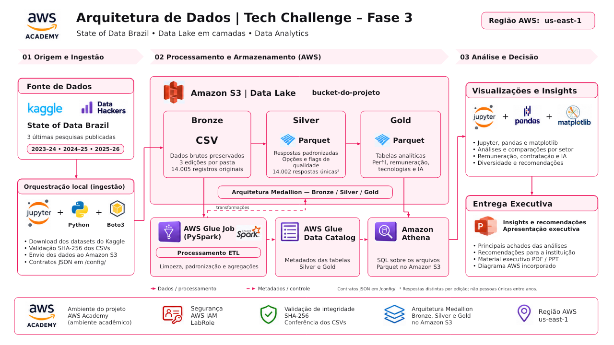

# Mercado brasileiro de Dados e Inteligência Artificial

**Tech Challenge — Fase 3 | Pós-Tech Data Analytics — FIAP**

Engenharia de Dados na AWS e análise de três edições do **State of Data Brazil** para apoiar contratação, capacitação e investimento em uma instituição financeira.



[Notebook completo](notebooks/Tech_Challenge_Fase3.ipynb) · [Apresentação PPTX](presentation/Tech_Challenge_Fase3.pptx) · [Apresentação PDF](presentation/Tech_Challenge_Fase3.pdf) · [Arquitetura Draw.io](assets/arquitetura.drawio)

A apresentação usa a identidade visual FIAP e uma narrativa sobre perfis, tendências e oportunidades. [Roteiro dos 15 slides](docs/roteiro_apresentacao.md).

## Resultado executivo

Foram preservados **14.005 registros originais** e obtidas **14.002 respostas** após remover três cópias exatas dentro de cada edição.

| Indicador — 2025–2026 | Resultado | Base de cálculo |
|---|---:|---|
| Análise de Dados no financeiro | 20,57% | 123 de 598 respostas do setor |
| Sêniores na faixa ≥ R$ 12.001 — financeiro | 66,53% | 165 de 248 |
| Sêniores na faixa ≥ R$ 12.001 — demais setores | 53,42% | 437 de 818 |
| Participação feminina em Engenharia de ML e IA | 15,24% | 16 de 105 com gênero informado |
| Uso declarado de IA | 98,14% | 2.061 de 2.100 respostas válidas |

As recomendações são mapear competências por função, calibrar referências salariais e conduzir pilotos de IA com métricas de tempo, qualidade, custo e segurança. Os percentuais descrevem a amostra; não demonstram causalidade ou demanda por vagas.

## Perguntas de negócio

1. Como se estrutura o mercado de Dados e IA?
2. Quais perfis apresentam maior valorização na amostra?
3. Como varia a participação feminina por cargo?
4. Quais tecnologias orientam a capacitação?
5. Qual a adoção declarada de IA e o que se pode concluir sobre produtividade?
6. Como região, senioridade e modelo de trabalho se relacionam?
7. Quais ações propor para contratação, capacitação e investimento?

[Respostas e recomendações](results/insights_e_recomendacoes.md)

## Arquitetura AWS



Kaggle → Jupyter/Boto3 → S3 Bronze → AWS Glue/PySpark → S3 Silver/Gold. O Glue Data Catalog registra metadados; o Athena consulta os arquivos Parquet para análises no Jupyter. Os contratos JSON são armazenados em `/config/`. A ingestão verifica SHA-256.

## Estrutura do projeto

| Pasta | Conteúdo |
|---|---|
| `notebooks/` | Execução integrada e análises com saídas preservadas |
| `presentation/` | Material executivo em PowerPoint e PDF |
| `results/` | Tabelas agregadas e respostas executivas |
| `src/` | ETL PySpark para Glue e validador local |
| `sql/` | Consultas Athena extraídas do notebook |
| `config/` | Contratos de campos, opções e hashes |
| `assets/` | Capa, arquitetura e arquivo Draw.io editável |
| `data/raw/` | Destino local dos CSVs baixados; ignorados pelo Git |
| `docs/` | Reprodução, fontes e metodologia |

## Como reproduzir

```bash
python -m venv .venv
# Windows: .venv\Scripts\activate
# Linux/macOS: source .venv/bin/activate
pip install -r requirements.txt
jupyter lab
```

Abra o notebook e execute na ordem, após configurar seu perfil local do AWS Academy. O notebook realiza ingestão S3, execução Glue e consultas Athena. [Instruções completas](docs/reproducao.md).

```bash
python src/validar_projeto.py
```

O validador e o workflow GitHub Actions verificam estrutura e sintaxe, sem executar a AWS. As faixas de dependências não reproduzem um ambiente congelado da execução original.

## Fontes e limitações

Três edições: **2023–2024, 2024–2025 e 2025–2026**. [Fontes e definições](docs/fontes_e_metodologia.md).

- Dados voluntários e autorreferidos; sem representatividade estatística presumida.
- Salários nominais em faixas, com cargos e vínculos diferentes nos recortes.
- Preferência e uso de tecnologias não são perguntas intercambiáveis.
- Em 2025–2026, respostas válidas de IA cobrem 60,10% da edição; adoção não mede impacto causal na produtividade.
- Pequenos grupos regionais exigem cautela; Norte N=36.

Os CSVs individuais e as credenciais AWS não são incluídos no pacote. Dados e mapeamentos derivados: **CC BY-NC-SA 4.0**, com atribuição a Data Hackers / Bain.

## Autoria

**Emerson Meira — Grupo 48**  
Pós-Tech Data Analytics · FIAP · Tech Challenge Fase 3.
